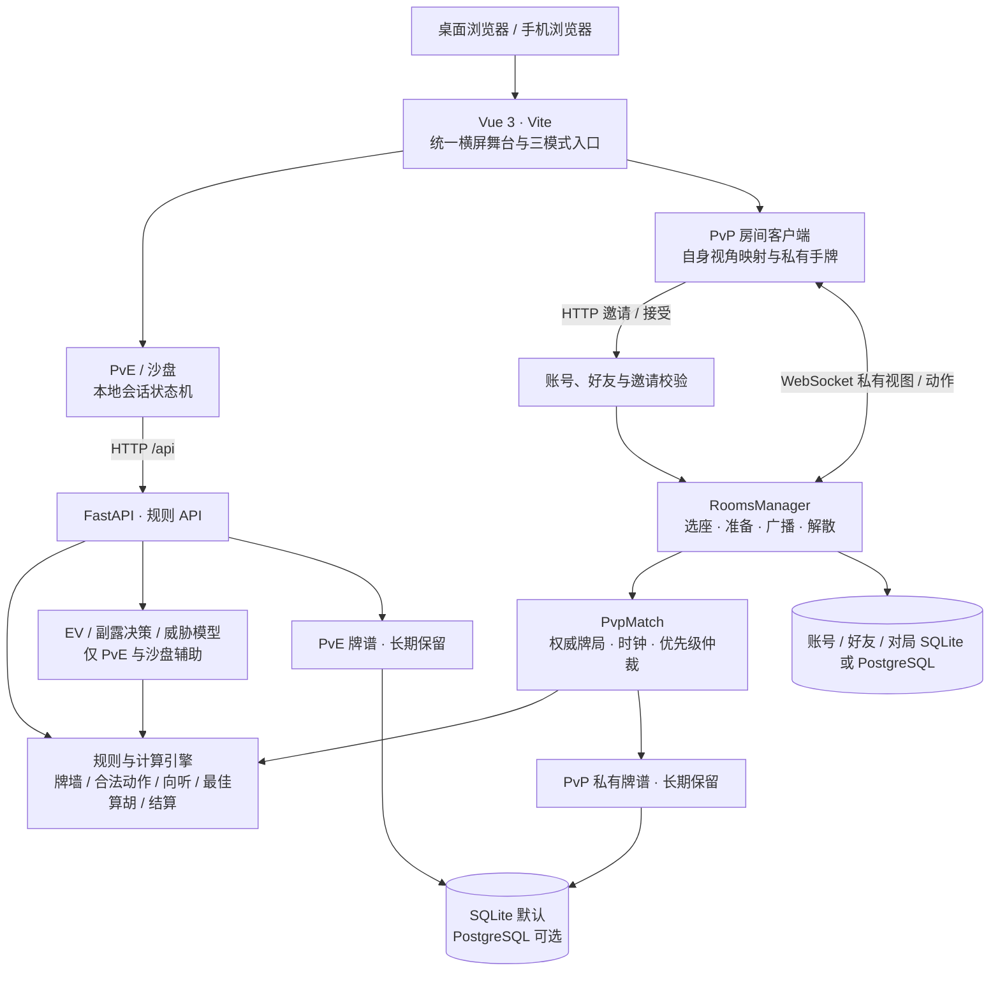

<div align="center">

# 顶龙麻将

**一桌东方雅趣，一场实时博弈。**

以现代 Web 技术复刻顶龙牌桌：人机磨砺、真人对战、残局推演，共用一套规则与算胡引擎。

[](https://github.com/Karry1123/DingLongMahjong/actions/workflows/deploy.yml)
[](https://github.com/Karry1123/DingLongMahjong/releases/tag/v0.6.1-beta)


[规则与配例](rule.md) · [快速启动](#快速启动) · [系统架构](#系统架构) · [更新日志](CHANGELOG.md) · [局域网联机](docs/lan-preview.md) · [测试诊断](docs/audit-2026-09-28.md)

</div>

---

> **当前版本 v0.6.1-beta**（2026-10-23）：修复人机对战中在非出牌阶段点击手牌会导致手牌数错误的问题——现在手牌点击、拖拽只在自家切牌阶段生效，会话层与后端同时校验轮次与阶段，连点只发一次切牌。网页层更新，App 会静默热更新。上一版本 v0.6.0-beta 上线了设计系统 v1。详见 [更新日志](CHANGELOG.md#v061-beta--2026-10-23)。

## 目录

- [三种模式](#三种模式)
- [项目亮点](#项目亮点)
- [系统架构](#系统架构)
- [快速启动](#快速启动)
- [测试与构建](#测试与构建)
- [部署与存储](#部署与存储)
- [已知问题与运行边界](#已知问题与运行边界)
- [版本演进与路线图](#版本演进与路线图)
- [参与开发](#参与开发)

## 三种模式

| 模式 | 体验 | 辅助边界 |
| --- | --- | --- |
| **人机对战 · PvE** | 与 AI 同桌磨砺牌技，观察牌形与攻守转换 | 切牌／副露 EV、进张、动态局势推演 |
| **玩家对战 · PvP** | 2～4 位真人同桌，空位由 AI 补齐 | 隐藏 EV、向听、进张、个人危险度；仅保留公开局势提示 |
| **全景沙盘 · Sandbox** | 自由摆牌、推演残局、验证胡数 | 四家可见，与对局共用规则和算胡引擎 |

## 项目亮点

### 牌桌：一套组件，三种模式

- 墨绿桌面、温润牌面、国风金色点缀；PvE 与 PvP 复用同一套牌桌、手牌、副露、牌河与结算组件。
- 1280×720 逻辑舞台按视口等比缩放，手机竖屏自动旋转为横屏布局。
- 开局财神亮相三秒，随后平滑归入中央牌槽。
- 自动理牌开启时，普通牌按花色点数排列，仅财神／白板替身可拖拽插位，插位锚点在后续摸打和副露中保持；关闭后全手自由排序。
- AI 一般思考六秒出牌、三秒响应；复杂计算超时则算完即行动。

### 联机：后端权威，各看各的主视角

- 账号登录后按账号添加好友，邀请 1～3 位好友直接开桌；无房间号、无公开匹配。四方固定选座、房主标记、全员准备与 3-2-1 同步开局。
- 自己永远在屏幕下方；玩家身份与累计分数绑定物理座位，门风每局按庄家重排：庄家东、下家南、对家西、上家北，显示与算番同步。
- 发牌、合法动作与抢断仲裁均由后端判定。出牌 **10 秒**、副露响应 **6 秒**，每家每局另有 **30 秒 Time Bank**；胡／碰／杠未决时，下家的吃牌时钟挂起。
- 一局结束后，全员确认才进入下一局。

### 公平与隐私

- PvP 不调用 EV／威胁辅助接口，不公开对手暗手。
- 鸣牌决策期间，其他玩家只看到中立的公共等待提示，看不到个人倒计时和时间池，避免暴露搭子倾向。
- 暗杠统一“三盖一明”，全场公开杠牌种类。
- PvP 完整牌谱存入独立私有库，长期保留供后台排查；玩家界面不开放 PvP 复盘。PvE 牌谱（云端长期保留、列表分页 + 本机 10 局缓存）单独管理。

### 移动端体验


- 进入对局时尝试原生全屏；不支持时以固定视口铺满，并保留手动全屏按钮。
- 浏览器支持 Screen Wake Lock 时申请屏幕常亮，切回页面后重新申请。
- 音效通过 Web Audio 按需拉取解码；摸牌与轮到自己操作时有短促提醒。

#### App

Capacitor App 与网页共用账号、好友、邀请对战页面，提供原生会话持久化、牌桌横屏、常亮及前后台重连。Android 优先，iOS 仅准备工程，构建需 macOS。推送到 `main` 后 GitHub Actions 自动构建签名 APK 并挂到对应版本的 Release，App 内会提示下载新版本。详见 [App 构建与真机调试](docs/mobile-app.md)。

### 规则：胡数与账目分开核算

- 136 张牌、白板固定替身、真财神万能成牌、底胡 10、刻杠明暗胡数、本门自风与三元翻、硬碰硬和得还原、清／混一色、辣子与多方轧差，统一由同一引擎计算。
- **严格不设圈风翻番**，也不附加未实现的日麻番种。
- 推荐策略与行牌合法性分开定义，算胡与推荐共享最佳拆解逻辑。
- [rule.md](rule.md) 提供可复算配例，例如 GM-4720EF 的“碰一万、切中叫听”，以及红中明刻叠加白板替身暗刻时的胡数分配。

## 系统架构



| 路径 | 职责 |
| --- | --- |
| `frontend/src/components/` | 共用牌桌、牌面、操作面板、房间与结算 UI |
| `frontend/src/composables/` | PvE 会话、自动推进、房间连接、全屏与方向适配 |
| `frontend/src/utils/` | 手牌锚定、视角映射、时钟、局势文案、音效与常亮 |
| `backend/app/api/` | HTTP 规则接口与房间 WebSocket 入口 |
| `backend/app/core/` | 规则、计分、推荐、房间调度与存储 |
| `backend/tests/`、`frontend/tests/` | 规则、契约、状态机及组件回归 |
| `frontend/scripts/` | 浏览器联调、布局检查与多窗口冒烟脚本 |
| `docs/` | 架构、联机说明、发布说明与诊断报告 |

## 快速启动

**环境要求：** Node.js 22.12+、Python 3.11、支持现代 Web API 的浏览器。以下命令以 Windows PowerShell 为例，均从项目根目录开始；前后端需各开一个终端。

### 1 · 启动后端

```powershell
cd backend
py -3.11 -m venv .venv          # 已有 .venv 可跳过
.\.venv\Scripts\python.exe -m pip install -r requirements.txt
.\.venv\Scripts\python.exe -m uvicorn app.main:app --host 0.0.0.0 --port 8000 --reload
```

不需要激活虚拟环境。启动后可访问：

- 健康检查：[localhost:8000/health](http://localhost:8000/health)
- 交互式 API 文档：[localhost:8000/docs](http://localhost:8000/docs)

### 2 · 启动前端

```powershell
cd frontend
npm.cmd ci
npm.cmd run dev -- --host 0.0.0.0 --port 5173
```

浏览器打开 [localhost:5173](http://localhost:5173/)。

- 开发模式下 API 地址留空或设为 `/`，HTTP 与 WebSocket 统一经 Vite 的 `/api` 代理转发，手机访问时不会误连到手机自身的 localhost。
- `predev`／`prebuild` 会自动生成按需播放的 `.dat` 语音数据，无需手动准备。

### 3 · 手机局域网／热点联机

1. 手机与电脑连入同一网络，或让电脑连接手机热点。
2. 在电脑上运行 `ipconfig`，记下当前网卡的 IPv4 地址。
3. 手机访问 `http://<电脑IPv4>:5173/`；必要时在 Windows 防火墙中放行该端口。
4. 各端注册登录（注册码由 `backend/scripts/registration_codes.py` 生成并导入），互加好友后，一端在“邀请好友对战”中选择好友，其他端接受邀请。
5. 入座、换座、准备，全员就绪后同步开局。

> 走 Vite 代理时手机只需能访问 5173；直连后端还要放行 8000。热点重连可能导致 IP 变化。完整排查步骤见 [局域网预览说明](docs/lan-preview.md)，多浏览器联调脚本见 [PvP 联调文档](docs/pvp-phase1.md)。

## 测试与构建

```powershell
# 前端（在 frontend 目录）
node --test tests/*.test.js
npm.cmd run build

# 后端（在 backend 目录）
.\.venv\Scripts\python.exe -m pip install pytest httpx
.\.venv\Scripts\python.exe -m pytest -v --tb=long
```

**本地基线（2026-10-18，v0.4.2-beta）**

| 项目 | 结果 |
| --- | --- |
| 后端 pytest | 505 项通过，17 个子测试通过（不含两组耗时离线 AI 工具测试） |
| 前端 node:test | 141 项中 140 项通过，1 项失败（见[已知问题](#已知问题与运行边界)） |
| 生产构建 | 通过 |

以上为本地结果，不能替代物理手机、微信 WebView 或公网数据库验收。GitHub Pages 工作流只构建并部署前端，目前没有运行全量测试的 CI 阶段。逐用例清单与非失败警告见 [诊断报告](docs/audit-2026-09-28.md)。

## 部署与存储

生产构建必须配置 `VITE_API_BASE_URL`。部署自己的后端时，设为其 HTTPS 根地址：

```powershell
$env:VITE_API_BASE_URL = 'https://your-backend.example'
npm.cmd run build
```

构建产物位于 `frontend/dist/`。当前生产路径为 `/DingLongMahjong/`；更换托管子路径时需同步修改 Vite 的 `base`。

| 环境变量 | 用途 |
| --- | --- |
| `VITE_API_BASE_URL` | 生产前端访问的后端根地址；开发时可留空或设为 `/` |
| `ALLOWED_ORIGINS` | 额外允许的完整来源，逗号分隔；HTTP 与 WebSocket 共用 |
| `AUTH_DB_PATH` | 账号、好友、对局 SQLite 路径；配置 `DATABASE_URL` 时改用 PostgreSQL |
| `PVP_RECORD_DB_PATH` | PvP 私有牌谱 SQLite 路径；显式配置时优先于 PostgreSQL |
| `GAME_RECORD_DB_PATH` | PvE 牌谱 SQLite 路径；显式配置时优先于 PostgreSQL |
| `DATABASE_URL` | PostgreSQL 连接地址；未配置对应 SQLite 路径时启用 |

默认数据库位于 `backend/data/`，不纳入版本库。云服务的临时文件系统不保证 SQLite 在重启后保留，长期保存牌谱请配置持久存储。部署入口参考 [DEPLOY.md](DEPLOY.md) 与 [render.yaml](render.yaml)；联机相关约束以本 README 与 PvP 文档为准。

## 已知问题与运行边界

- **单实例运行：** 房间连接与权威牌局保存在进程内，必须以 **单 Uvicorn worker、单服务实例** 运行。数据库持久化不代表房间可跨实例恢复；多实例部署需要共享状态与广播设计。
- **断线处理：** 真人玩家断线后有 60 秒重连宽限，等待阶段取消倒计时，对局中服务端时钟照常运行；超过宽限则整桌结束。服务重启会中止所有未结束对局。
- **屏幕常亮：** Screen Wake Lock 需要浏览器支持且处于安全上下文，普通局域网 HTTP 通常无法申请；需要时请使用可信 HTTPS。横屏适配本身不依赖全屏许可。
- **前端回归失败 1 项：** `tests/pveBoard.test.js` 中“结算仅横置吃进牌与胡牌”用例期望 2 张横置牌，实际渲染 4 张。该失败自 v0.3.2-beta 起存在，待排查是渲染逻辑还是断言需要随 v0.3.2 的横置规则更新。

## 版本演进与路线图

| 版本 | 日期 | 重点 |
| --- | --- | --- |
| v0.1.1-beta | 2026-09-24 | 副露供牌绑定、牌河扣减、状态步进、早期移动端布局 |
| 0.2.2-beta | 2026-09-27 | 顶龙品牌、牌面设计、财神仪式、推荐逻辑与微缩排版 |
| 0.2.3-beta | 2026-09-27 | 取消圈风翻番、局势提示、自摸区分、手牌财神锚定、碰听推荐纠偏 |
| 0.2.4-beta | 未单独发布 | 开发阶段：分步接入房间、权威牌局与联机交互 |
| v0.3.1-beta | 2026-09-28 | 三模式入口、PvP 联机、视角映射、双倒计时与 Time Bank、共用结算、500 局私有牌谱、常亮与鸣牌隐私、统一规则文档 |
| v0.3.2-beta | 2026-09-28 | 修复 PvP 换庄后门风轮转与自风算番；修复结算中吃进牌横置显示 |
| v0.3.3-beta | 2026-10-11 | README 重整、测试基线校准、已知问题公开 |
| v0.4.0-beta | 2026-10-16 | 账号 + 注册码 + 好友邀请对战取代房间号；Capacitor App 工程；AI 权重 V1 接入与调优工具链；V3 调优设计 |
| v0.4.1-beta | 2026-10-17 | App 离局与安全区修复；自动构建 APK 与应用内更新；V3 第一小轮调优执行（未晋升） |
| v0.4.2-beta | 2026-10-18 | V4 调优收尾；敏感度扫描、杠专项、功效分析与序贯检验；三轮均未晋升，生产权重不变 |
| v0.4.3-beta | 2026-10-18 | 修复 App 更新提示；正式版发布、后端版本接口、设置页检查更新 |
| v0.4.4-beta | 2026-10-21 | 「發」牌 App 图标、启动画面与网页 favicon |
| v0.5.0-beta | 2026-10-21 | App 静默热更新与 App 内一键安装新 APK |
| v0.6.0-beta | 2026-10-23 | 设计系统 v1，统一令牌、国风纹样，大厅与牌桌全面迁移 |
| **v0.6.1-beta** | **2026-10-23** | **当前版本**：修复人机对战非出牌阶段点手牌导致牌数错误 |

各版本完整记录见 [CHANGELOG.md](CHANGELOG.md)，发布摘要见 [docs/releases/](docs/releases/)。

**路线图**

- [ ] 修复前端结算横置牌回归用例，恢复前端全绿。
- [ ] 整理测试基础设施：隔离 Vite HMR 端口与缓存，减少并行测试噪声。
- [ ] CI 加入前后端全量回归与可复现的多窗口冒烟。
- [ ] 真机矩阵：iOS Safari、Android Chrome、微信 WebView 的全屏与常亮验收。
- [ ] PostgreSQL 云端存储与跨部署保留在部署环境中的验收。
- [ ] 在保证仲裁一致性和隐私边界的前提下，设计房间共享状态与多实例调度。

## 参与开发

- **规则变更：** 请附上具体物理牌型、财神身份、座位风、胡张归属及可复算结果，并核对合法动作、赢家算胡、未胡固有胡与推荐计算。
- **界面变更：** 需覆盖桌面、手机竖屏旋转，以及所有自身座位视角。
- **测试失败：** 先保存完整日志、定位原因，不要为了迎合断言而修改规则。
- **许可证：** 项目目前没有独立的开源许可证文件；贡献或再分发前请先明确授权条款。

---

<div align="center">

**摸打有章，胜负有据。**

顶龙麻将 · 从一张牌，推演一桌局。

</div>
